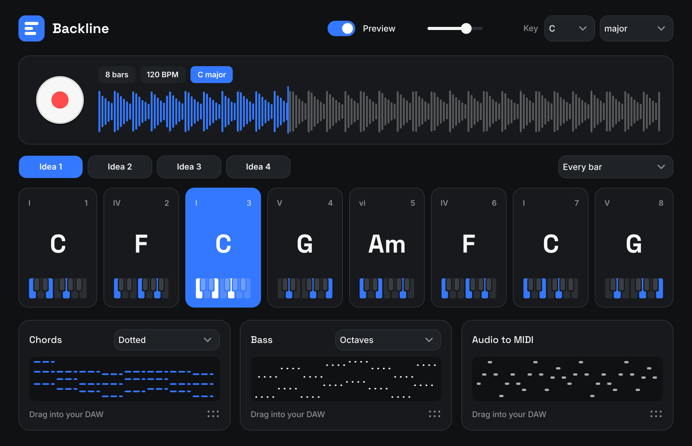

# Backline

An original audio plugin (VST3 / AU / standalone) that listens to audio in your DAW and
suggests chords and a bassline that fit it. Written from scratch with JUCE; it contains no
code, models or content from any commercial product.



## What it does today

- **Record** audio from the track it sits on, in time with the host transport.
- **Detect the key** of the recording (you can override it).
- **Suggest four chord progressions** that fit the audio, one chord per 2 beats, bar or 2 bars.
- **Edit chords**: click a chord to swap it for an alternative, ranked by how well it fits.
- **Chord and bass rhythm presets**, previewed with a built-in synth in sync with the DAW.
- **Audio to MIDI** for single-note material (vocals, leads, basslines).
- **Drag MIDI** for chords, bass and the converted audio straight onto a DAW track.

Not built yet: stem separation, polyphonic audio-to-MIDI, WAV export, effects, hosting
other instruments, drums.

## Using it

1. Put Backline on the audio track you want to build around.
2. Start playback, press the record button, let a few bars play, then press it again
   (or stop the DAW). If you start mid-bar, Backline waits for the next bar line.
3. Try the ideas 1-4, click chords to change them, pick rhythms.
4. Drag the MIDI tiles onto instrument tracks.

## Building

Needs CMake 3.22+ and a C++17 compiler. JUCE is downloaded automatically.

```bash
cmake -S . -B build -DCMAKE_BUILD_TYPE=Release
cmake --build build --config Release --parallel
ctest --test-dir build -C Release --output-on-failure
```

The plugin ends up in `build/Backline_artefacts/Release/`. Every push builds the Windows
version in GitHub Actions, validates it with pluginval and uploads a `Backline-Windows`
package containing `Backline.vst3`, the standalone `Backline.exe` and `Install.bat`.

On Linux install first: `libasound2-dev libx11-dev libxrandr-dev libxinerama-dev libxcursor-dev
libxext-dev libfreetype-dev libfontconfig1-dev libgl1-mesa-dev`.

## Layout

- `core/` - analysis and harmony engine, plain C++ with no dependencies
- `plugin/` - JUCE plugin (audio capture, preview synth, interface)
- `tests/` - engine tests, an end-to-end plugin test with a simulated transport, and a tool
  that renders the interface to PNG (`backline_screenshot <dir>`)

JUCE is used under its AGPLv3 option, which is fine for personal and open-source use.
