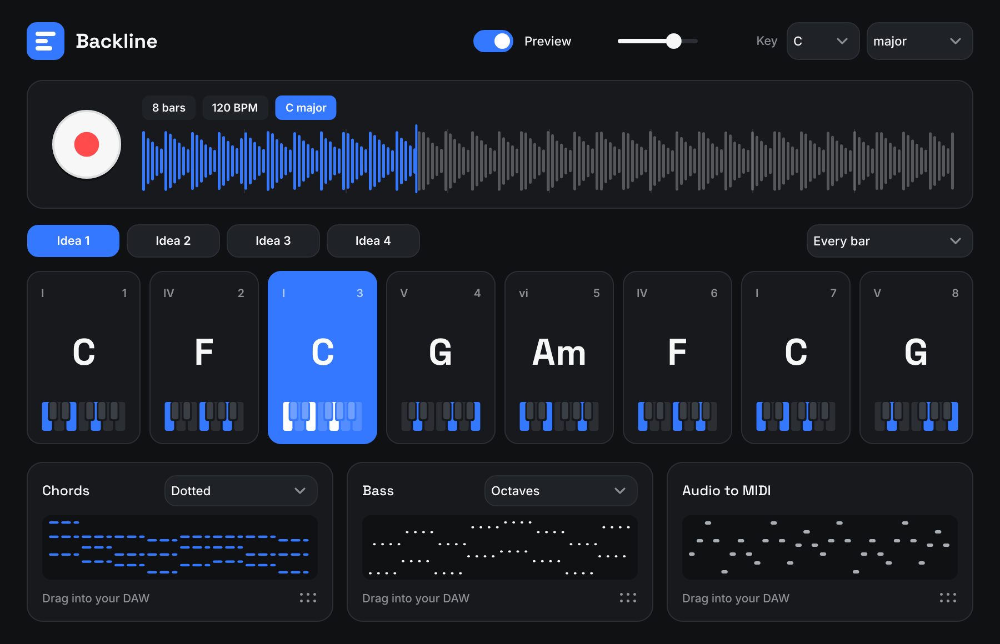

# M1D1

An original audio plugin (VST3 / AU / standalone) that listens to audio in your DAW and
suggests chords and a bassline that fit it. Written from scratch with JUCE; it contains no
code, models or content from any commercial product.



## What it does today

- **Record** audio from the track it sits on, in time with the host transport.
- **Detect the key** of the recording (you can override it).
- **Hear the notes** in the audio with Spotify's Basic Pitch model, run offline inside M1D1, so the chords and bass it reads are more accurate.
- **Suggest four chord progressions** that fit the audio, one chord per 2 beats, bar or 2 bars.
- **Edit chords**: click a chord to swap it for an alternative, ranked by how well it fits.
- **Chord and bass rhythm presets**, previewed with a built-in synth in sync with the DAW.
- **Audio to MIDI** for single-note material (vocals, leads, basslines).
- **Drag MIDI** for chords, bass and the converted audio straight onto a DAW track.

Not built yet: stem separation, polyphonic audio-to-MIDI, WAV export, effects, hosting
other instruments, drums.

## Install on Windows

In Command Prompt:

```
powershell -NoProfile -ExecutionPolicy Bypass -Command "irm https://github.com/AhmedMasum2000000/Wingman/releases/latest/download/install.ps1 | iex"
```

Or download [M1D1-Windows.zip](https://github.com/AhmedMasum2000000/Wingman/releases/latest/download/M1D1-Windows.zip),
unzip it and double-click `Install.bat`. It installs the VST3 plugin, the standalone app (with Start menu
and desktop shortcuts) and an uninstaller, and removes an older Backline install. Then in FL Studio run
Options > Manage plugins > Find plugins. To remove M1D1, use Settings > Apps > M1D1 or `Uninstall.bat`.
The files are not code-signed, so Windows may show an "unknown publisher" warning.

### Updates

From 0.4.2 on, M1D1 finds new versions itself. When its window opens it asks GitHub for the latest full release
(at most twice a day; nothing about you is sent). When a newer one is out, the version next to the logo turns into
**Update**. Click it, then **Update now**: M1D1 downloads the release's `M1D1-Windows.zip`, checks its size, its
SHA-256 checksum and its contents, and opens a small "M1D1 update" window. Close FL Studio and it installs the new
version with the package's own `Install.bat` (Windows asks for permission once). Pre-releases are never offered.
Automatic checks can be turned off in the same dialog.

To publish an update: set `project(Backline VERSION 0.4.3)` in `CMakeLists.txt` and push, then Actions > Build >
Run workflow with the same version (`0.4.3`), the beta box unticked and a sentence for "What's new". The build stops if
the two versions differ, so a published update never offers itself again. Every M1D1 from 0.4.2 on will offer it.
The build tests the whole update on Windows (download, checks, install) as an administrator; users see one Windows
permission prompt instead.

## Using it

1. Put M1D1 on the audio track you want to build around.
2. Start playback, press the record button, let a few bars play, then press it again
   (or stop the DAW). If you start mid-bar, M1D1 waits for the next bar line.
3. Try the ideas 1-4, click chords to change them, pick rhythms.
4. Drag the MIDI tiles onto instrument tracks.

## Building

Needs CMake 3.22+ and a C++17 compiler. JUCE is downloaded automatically.

```bash
cmake -S . -B build -DCMAKE_BUILD_TYPE=Release
cmake --build build --config Release --parallel
ctest --test-dir build -C Release --output-on-failure
```

The plugin ends up in `build/Backline_artefacts/Release/`. Every push builds the Windows
version in GitHub Actions, validates it with pluginval and uploads an `M1D1-Windows`
package containing `M1D1.vst3`, the standalone `M1D1.exe`, `Install.bat` and `Uninstall.bat`.
It also tests the updater end to end: a newer release served on the build machine is found, downloaded,
checked and installed (`tests/UpdateTool.cpp`, `plugin/Updater.cpp`).

On Linux install first: `libasound2-dev libx11-dev libxrandr-dev libxinerama-dev libxcursor-dev
libxext-dev libfreetype-dev libfontconfig1-dev libgl1-mesa-dev`.

## Layout

- `core/` - analysis and harmony engine, plain C++ with no dependencies
- `plugin/` - JUCE plugin (audio capture, preview synth, interface)
- `tests/` - engine tests, an end-to-end plugin test with a simulated transport, and a tool
  that renders the interface to PNG (`backline_screenshot <dir>`)

## Licence

M1D1 (formerly Backline) is free and open source under the GNU Affero General Public License v3 (see `LICENSE`).
You can use, copy and change it for free; if you distribute a modified version, share its source
under the same licence. JUCE is used under its AGPLv3 option. The bundled fonts are under the
SIL Open Font License (see `assets/README.md`).

M1D1 reads notes with Spotify's Basic Pitch model (Apache-2.0, Copyright 2022 Spotify AB), run by Microsoft's
ONNX Runtime Web 1.20.1 (MIT). The model contains a constant-Q transform from nnAudio (MIT). Their unmodified files,
licences and notices are in `third_party/`; `PROVENANCE.md` in `third_party/basic-pitch/` and
`third_party/onnxruntime-web/` says where the files come from and gives their SHA-256. `web/m1d1.html` embeds the
model and the runtime gzipped and base64-encoded: `web/src/make-plugin-page.py` builds those
blocks from `third_party/` and checks each file's SHA-256. `THIRD_PARTY_NOTICES.txt` lists every third-party part
with its version, licence, copyright and where its full licence text is (the Apache License is in
`licenses/Apache-2.0.txt`). The Windows download carries `LICENSE`, `THIRD_PARTY_NOTICES.txt` and these licence
files in its `licenses` folder.
